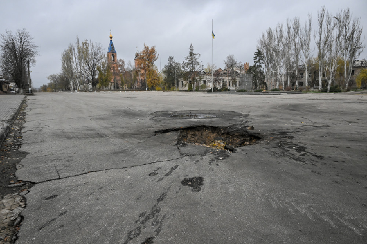
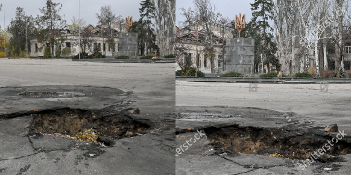
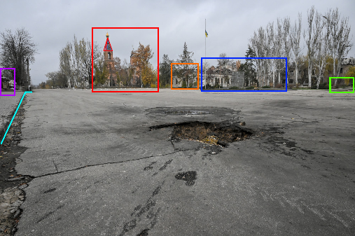
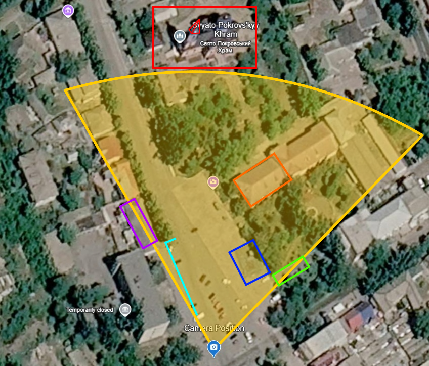
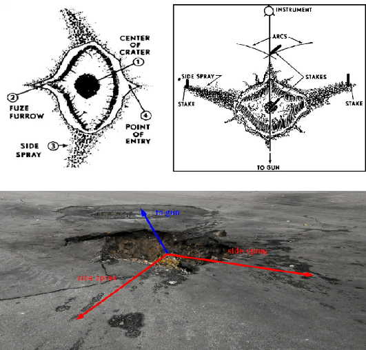

# OSINT INVESTIGATION REPORT

**Case:** Point of Origin  
**Case source:** [Bellingcat Challenge #93](https://challenge.bellingcat.com/challenge/93/)  
**Case author:** [Trevor Ball (Bellingcat)](https://www.bellingcat.com/author/trevorball/)  
**Date:** 31.10.2026  
**Version:** 1.0  
**Written by:** [fondgard](https://github.com/fondgard)  

[**Download original PDF**](Point_of_Origin_Report.pdf)

## Contents
1. [Introduction](#1-introduction)
2. [Investigation Objectives](#2-investigation-objectives)
3. [Scope and Methodology](#3-scope-and-methodology)
4. [Analytical Section](#4-analytical-section)
   * 4.1. [Analysis of Geolocation](#41-analysis-of-geolocation)
   * 4.2. [Analysis of the Crater](#42-analysis-of-the-crater)
   * 4.3. [Ammunition Assessment and Origin Context](#43-ammunition-assessment-and-origin-context)
5. [Conclusion](#5-conclusion)
6. [Sources](#6-sources)
7. [Glossary](#7-glossary)

## 1. Introduction

This report details an open-source intelligence (OSINT) investigation based on an artillery strike on the frontline town of Orikhiv, Zaporizhzhia Oblast, Ukraine. The strike is documented in a photograph by photojournalist Dmytro Smolienko (see Figure 1), which shows an artillery crater on the street. In the background are located civilian buildings, including the damaged Church. [1]

  
*Figure 1. Photo of strike by Dmytro Smolienko*

## 2. Investigation Objectives

* Determination of the point of origin for artillery
* Identification of the trajectory of the strike
* Determination of the possible type of ammunition used
* Identification of potential military units positioned along the line of fire

## 3. Scope and Methodology

This report relies on open-source materials, primarily focusing on visual evidence. The investigative methodology consists of four main phases:

* **Visual Geolocation:** Cross-referencing photo landmarks with satellite imagery to pinpoint the crater's exact coordinates and camera orientation.
* **Crater Analysis:** Examining the crater's shape and spoil pattern to determine the shell's trajectory and point of origin.
* **Ammunition Estimation:** Estimating payload size from crater dimensions and using open-source databases to identify the likely munition type.
* **Unit Identification:** Overlaying firing direction and weapon range onto historical front-line maps to identify military units positioned along the line of fire.

## 4. Analytical Section

### 4.1. Analysis of Geolocation 

At the start of the investigation, a search was conducted using the attached photograph. Matches were found with images from the town of Orikhiv in the Zaporizhzhia region. Specifically, a photograph from Shutterstock shows a similar monument and a crater (see Figure 2). Moreover, the picture by Serhii Okunev, published on the NV portal has the same monument and church, which fully confirms the city (see Figure 3). [2][3]

  
*Figure 2. On the left is a fragment of the original photo; on the right is a photo from Shutterstock [2]*

  
*Figure 3. Photo by Serhii Okunev / NV from Orikhiv [3]*

Using the church in the photograph as a reference point, the approximate location where the picture was taken was identified. Subsequently, by utilizing various visual anchors, the exact location was determined (see Figure 4 & 5). The location is confirmed as Pokrovska St. (ukr. вул. Покровська). Based on the alignment of the visual anchors, the camera is facing directly north.

  
*Figure 4. Photograph with annotations of key details*

  
*Figure 5. This location from Google Earth with the same key details marked*

### 4.2. Analysis of the Crater

According to standard military guidelines on crater analysis, such as those documented in the US Army Crater Analysis reports, a low-angle artillery impact creates a crater that points towards the weapon’s general direction. Furthermore, as outlined by Armament Research Services, evaluating the spoil and side spray patterns allows investigators to establish the precise azimuth of the incoming projectile. [4][5]

Analysis of the crater's morphology, based on the imagery, revealed pronounced soil ejections (side spray) directed towards the camera and to the right. Applying the "side spray" method, the central axis of the impact points away from the camera. Given that the camera is facing north, it is determined that the projectile was fired from a northern direction (see Figure 6).

  
*Figure 6. The side spray method [4][5]*

### 4.3. Ammunition Assessment and Origin Context

Based on the established northern trajectory, the point of origin lies within territory controlled by Ukrainian armed forces at the time of the incident. This indicates that the crater is likely the result of a “short round” (an accidental impact caused by technical malfunction, barrel wear, or charge miscalculation during outgoing fire towards southern positions).

The morphological characteristics of the crater, specifically its size and the low-angle impact pattern, are consistent with heavy artillery projectiles. Given the origin, potential munitions include Soviet 122mm and 152mm shells, or NATO-standard 155mm rounds commonly utilized by Ukrainian artillery units. Alternatively, an air defense system failure must be considered.

## 5. Conclusion

This OSINT investigation traced the artillery strike to Pokrovska Street in Orikhiv, Zaporizhzhia Region. By analyzing the crater’s shape and blast pattern, the trajectory was confirmed to originate from the north. 

Given the front-line positions at the time, this northern origin points to a likely incident of friendly fire from Ukrainian-controlled territory, possibly a heavy artillery shell falling short or a malfunctioning air defense missile. However, while the crater’s geometry confirms the direction of the strike, the exact weapon type and cause cannot be definitively proven without examining the physical munition debris.

## 6. Sources

[1] Bellingcat, Challenge #93 “Point of Origin” - https://challenge.bellingcat.com/challenge/93/
Date of access: 31.10.2026

[2] Shutterstock, Images “Front-line Orikhiv in southeastern Ukraine suffers from daily Russian shelling - 13 Nov 2025” - https://www.shutterstock.com/editorial/image-editorial/impact-russian-shelling-street-near-ukrainian-coat-15840451q
Date of access: 31.10.2026

[3] The New Voice of Ukraine (NV), Article “Ukraine braces for potential Russian assault on Zaporizhzhia amid quiet December” - https://english.nv.ua/russian-war/ukraine-braces-for-possible-russian-assault-on-zaporizhzhia-as-defenses-strengthen-50479063.html
Date of access: 31.10.2026

[4] Armament Research Services (ARES), Article “An Introduction to Crater Analysis” - https://armamentresearch.com/an-introduction-to-crater-analysis/
Date of access: 31.10.2026

[5] U.S. Army, Document “1992 US Army Crater Analysis and Shell Reports“ - https://www.scribd.com/document/175669106/1992-Us-Army-Crater-Analysis-and-Shell-Reports-49p
Date of access: 31.10.2026

## 7. Glossary

* **Azimuth** - A horizontal angle measured clockwise from a true north base line, used to determine the exact directional vector of an incoming munition.
* **Crater Morphology** - The physical shape, dimensions, and structural characteristics of an impact site used to analyze the type, payload, and trajectory of a projectile.
* **Geolocation** - The methodological process of identifying the precise real-world geographic coordinates of a location depicted in digital media by cross-referencing visual landmarks with satellite imagery.
* **Low-Angle Impact** - A strike by a projectile arriving on a relatively flat trajectory, typical of heavy field howitzers, resulting in distinct directional furrows and asymmetric ejecta patterns.
* **OSINT (Open-Source Intelligence)** - The systematic collection, verification, and analysis of publicly available information to generate actionable investigative intelligence.
* **Point of Origin** - The specific geographic location from which a weapon system was fired.
* **Short Round** - An artillery projectile that falls short of its intended target due to propellant miscalculation, barrel wear, equipment malfunction, or operator error.
* **Side Spray** - The lateral dispersion of soil and debris upon a munition's impact, utilized in crater analysis to calculate the reverse trajectory toward the weapon's firing position.
* **Spoil Pattern / Ejecta** - The specific distribution of displaced earth, fragmented asphalt, and debris scattered around a crater immediately following an explosion.
